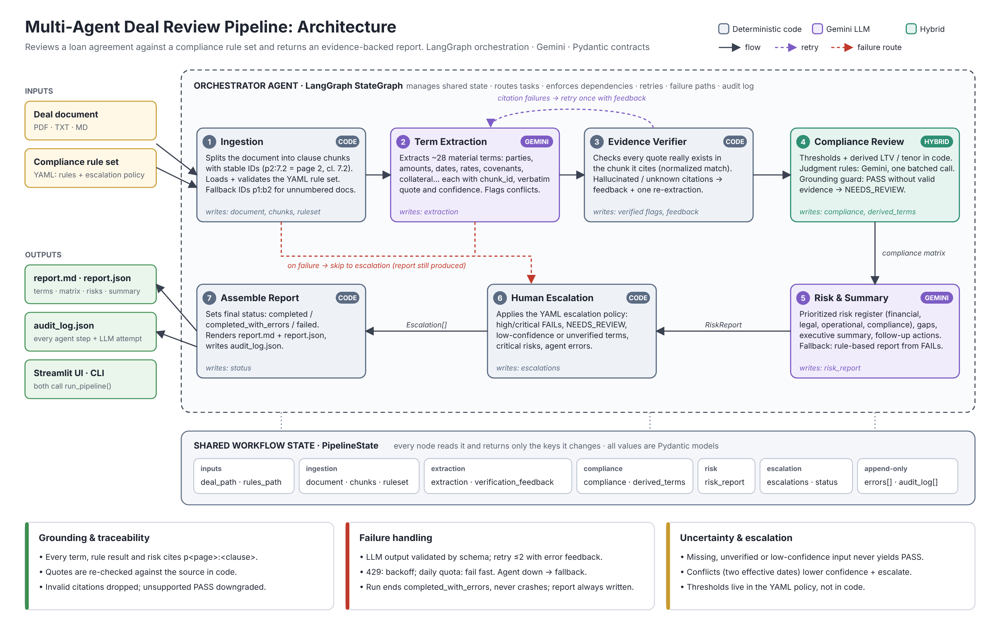

# Multi-Agent Deal Review Pipeline

A multi-agent system that reviews a commercial loan agreement against an explicit credit
policy. It produces an evidence-backed report with:
- extracted terms
- a compliance matrix
- a prioritized risk register
- an executive summary

Every claim in the report points back to a page and clause of the source document.
Uncertain or high-risk findings are escalated to a human.

**Stack:** LangGraph (orchestration) · Google Gemini (`gemini-3.8-flash`) · Pydantic (agent contracts) · PyMuPDF · Streamlit · pytest



A one-page PDF of the diagram is in [`docs/architecture.pdf`](docs/architecture.pdf).

---

## Quick start

```bash
git clone https://github.com/ishaan-77/multi_agent_project.git
cd multi_agent_project
python3 -m venv .venv
source .venv/bin/activate
pip install -r requirements.txt
cp .env.example .env
```

Open `.env` and paste your Gemini API key (from https://aistudio.google.com/apikey). Then:

```bash
python -m scripts.check_gemini
python run.py --deal samples/normal_loan.pdf
python run.py --deal samples/edge_case_loan.pdf
streamlit run app.py
python -m pytest -q
```

| Command | What it does |
|---|---|
| `python -m scripts.check_gemini` | Verifies the key, plain calls and structured output |
| `python run.py --deal <file> [--rules <yaml>]` | Runs the CLI and writes `outputs/<deal>/report.md`, `report.json` and `audit_log.json` |
| `streamlit run app.py` | Opens the web UI: run or upload a deal, watch the agents live, explore the report |
| `python -m pytest -q` | Runs 26 tests using a fake LLM (offline, no API key needed) |
| `python -m scripts.show_chunks <file>` | Shows how the document was split into citable chunks |

You can review saved reports in `outputs/` or open them in the UI ("Open a saved report")
without calling the API.

---

## Agents

| # | Agent | Type | Responsibility | Writes to shared state |
|---|---|---|---|---|
| 1 | **Ingestion** | code | Splits the PDF/TXT/MD into one chunk per clause with stable IDs (`p2:7.2` = page 2, clause 7.2). Loads and validates the YAML rule set. Documents without numbered clauses get page-block IDs (`p1:b2`). | `document`, `chunks`, `ruleset` |
| 2 | **Term Extraction** | Gemini | Extracts ~28 material terms: parties, amounts, dates, pricing, covenants, collateral, obligations, events of default, conditions, exclusions. Each term has a `chunk_id`, a verbatim quote, a normalized value and a confidence. Conflicting or undefined values get confidence ≤ 0.5 and an explanatory note. | `extraction` |
| 3 | **Evidence Verifier** | code | Checks that every quote actually appears in the chunk it cites. A failure triggers **one** re-extraction with specific feedback. Anything still failing is marked `verified=false`. | verified flags, `verification_feedback` |
| 4 | **Compliance Review** | code + Gemini | Threshold rules (LTV, tenor, DSCR, exposure, reporting days) are evaluated **in code**, including derived metrics such as LTV = principal / collateral and tenor from the dates. Judgment and presence rules go to Gemini in one batched call, then through a grounding guard. Each rule gets PASS / FAIL / NEEDS_REVIEW with evidence and a rationale. | `compliance`, `derived_terms` |
| 5 | **Risk & Summary** | Gemini | Builds a risk register (financial, legal, operational, compliance) with severity, likelihood, evidence and a recommendation, sorted by severity × likelihood. Lists missing or ambiguous information, writes an executive summary and follow-up actions. | `risk_report` |
| 6 | **Human Escalation** | code | Applies the escalation policy from the YAML to everything above and lists what a human must review. | `escalations` |
| 7 | **Orchestrator** | LangGraph | Owns the shared state, routing, dependency order, the retry loop, failure routes and the audit log. Assembles the final report. | `status`, `audit_log` |

**Why some agents are code, not LLMs.** Chunk IDs, quote verification, arithmetic and
escalation rules must give the same answer on every run, and they have to be auditable.
Using an LLM there would add cost and non-determinism without improving the result.
The LLMs do the work that needs reading comprehension: extraction, judgment rules and risk analysis.

### Orchestration flow

```
ingest ──ok──▶ extract ──ok──▶ verify ──continue──▶ compliance ─▶ risk ─▶ escalate ─▶ assemble
   │              ▲              │
   │              └───retry──────┘   (citation failures, max 1 retry)
   └──failed──────┴──failed─────────────────────────────────────────▶ escalate
```

### Shared state and data handoffs

All agents share one `PipelineState` (`src/state.py`). Each node returns only the keys it
changes. `errors` and `audit_log` use an add-reducer, so agents append to them and can
never overwrite each other. Every message between agents is a Pydantic model:

| From → To | Contract |
|---|---|
| Ingestion → all | `Chunk{chunk_id, page, section, clause, text}`, `RuleSet` |
| Extraction → Verifier → Compliance/Risk | `ExtractionResult{terms[ExtractedTerm{value, normalized, evidence[Evidence{chunk_id, quote}], confidence, verified}], missing_terms}` |
| Compliance → Risk/Escalation | `ComplianceResult{rule_id, status, evidence, rationale, method}` |
| Risk → Escalation | `RiskReport{risks[Risk], gaps, executive_summary, follow_up_actions}` |
| Escalation → Report | `Escalation{source, reason, severity}` |

---

## Grounding and traceability

- Every term, compliance result and risk cites `p<page>:<clause>` IDs that are produced in code, not by the model.
- The **Evidence Verifier** re-checks every quote against the source text (whitespace, case and quote-style normalized, ≥ 90% token overlap).
- The **grounding guard** in Compliance drops citations to chunks that don't exist. A PASS left without valid evidence is downgraded to NEEDS_REVIEW.
- In the report, Markdown tables show the evidence IDs. The UI's **Evidence lookup** tab turns any ID back into the exact clause text.

## Failure handling

| Failure | Handling |
|---|---|
| Invalid or unparseable LLM output | Pydantic validation, then retry (up to `LLM_MAX_RETRIES=2`) with the error sent back to the model |
| Rate limit (429) | Exponential backoff, then retry |
| Daily quota exhausted | Fail fast, without pointless retries |
| Hallucinated citation | Verifier sends feedback for one re-extraction; anything still failing is marked unverified and escalated |
| Compliance LLM down | Code-checked rules still run; the rules Gemini would have judged become NEEDS_REVIEW |
| Risk LLM down | A rule-based risk report is built from the compliance FAILs and clearly labelled as a fallback |
| Extraction fails, or bad input (missing file, scanned PDF, invalid YAML) | Route straight to escalation with `status=failed`; a report is still written |
| Any agent error | Recorded in `errors`, raised as an escalation; the run ends `completed_with_errors` rather than crashing |

Every LLM attempt, success or failure, is written to `audit_log.json` with timing.

## Handling uncertainty

- **Uncertainty never produces a PASS.** If an input is missing, unverified or below `min_term_confidence`, the result is NEEDS_REVIEW. If even the uncertain value breaches the limit, the result is FAIL.
- **Conflicts are surfaced, not resolved silently.** For example, two different effective dates both get cited, the term's confidence drops, and the conflict is escalated.
- **Escalation thresholds live in the policy YAML** (`escalation:`), not in code:

```yaml
escalation:
  on_fail_severity: [critical, high]   # FAILs at these severities escalate
  on_needs_review: true                # every NEEDS_REVIEW escalates
  min_term_confidence: 0.7             # low-confidence terms escalate
  on_risk_severity: [critical]         # LLM-judged risks that force escalation
```

---

## Validation: normal case and edge case

The synthetic inputs (`samples/`) were designed with a hand-written answer key
([`samples/EXPECTED.md`](samples/EXPECTED.md)).

| | Normal: `normal_loan.pdf` | Edge case: `edge_case_loan.pdf` |
|---|---|---|
| Deal | $12M secured term loan, clean | $40M bridge loan with planted defects |
| Terms verified | 28 / 28 | 21 / 21 |
| Compliance | 13 PASS | 2 PASS · 11 FAIL |
| Matches answer key | 13 / 13 | 13 / 13 |
| Top risk | medium | critical (LTV 88.9% on borrower's own estimate) |
| Decision | ✅ No escalation | 🔴 Escalate to human review |

The edge case caught all of the planted problems:
- LTV breach based on an unverified valuation
- margin defined only in a fee letter that isn't provided
- conflicting effective dates (1 Apr vs 1 May 2026)
- ~10-year tenor
- DSCR covenant of 1.10x
- 180-day reporting deadline
- missing guarantee, cross-default and prepayment clauses
- no use-of-proceeds restrictions

Sample outputs:
- [`outputs/normal_loan/`](outputs/normal_loan/): the full report for the normal case.
- [`outputs/edge_case_loan/`](outputs/edge_case_loan/): the full report for the edge case.
- [`outputs/edge_case_loan_quota_exhausted/`](outputs/edge_case_loan_quota_exhausted/): a real run where the Gemini daily quota ran out partway through. It shows graceful degradation: code-checked FAILs are still correct, the Gemini-judged rules become NEEDS_REVIEW, the risk report falls back to the rule-based version, and the deal is escalated. Status is `completed_with_errors`.

Automated tests (`tests/`, 26 tests, fake LLM) cover:
- chunking
- quote verification
- threshold logic and derived metrics
- the grounding guard
- the retry loop on a hallucinated quote
- LLM failure fallbacks
- daily-quota fail-fast
- escalation policy
- the end-to-end graph
- the Streamlit UI

---

## Assumptions

- Deals are text-based PDFs (or TXT/MD) with numbered clauses. Unnumbered documents still work, with page-level citations.
- The rule set is the source of truth. Thresholds and escalation policy are configuration, not code.
- A rule's `term:` field names the extracted term it checks, so threshold checks can run in code.
- Amounts are in a single currency (USD). There is no FX conversion.
- The pipeline supports a human decision; it doesn't make credit decisions itself.
- All data is synthetic. The parties, figures and the bank are fictional.

## Limitations and next steps

- **No OCR.** Scanned PDFs are rejected with a clear error.
- **Context size:** the whole document is sent in one prompt, which is fine for agreements of tens of pages. Very long documents would need retrieval or per-section extraction.
- **One extraction pass:** the verifier proves a quote exists, not that the model interpreted it correctly. Next step: a second-opinion agent for high-severity terms.
- **LLM variance:** judgment rules may differ between runs. For example, CR-13 sometimes comes back FAIL and sometimes NEEDS_REVIEW, and both are defensible. Threshold rules are deterministic.
- **Free-tier Gemini:** about 20 requests a day, and each review uses 3 calls. A paid key or a different `GEMINI_MODEL` removes this limit.
- **Not production-hardened:** there is no authentication, persistence layer or multi-user handling, and no human-in-the-loop resume after escalation. LangGraph's interrupt/checkpointing would be the natural next step.

---

## Project structure

```
├── app.py                    Streamlit UI
├── run.py                    CLI
├── rules/lending_policy.yaml 13-rule synthetic credit policy + escalation policy
├── samples/                  synthetic deals + answer key (EXPECTED.md)
├── outputs/                  sample reports (md, json, audit log)
├── docs/                     architecture diagram (svg, png, pdf)
├── scripts/                  check_gemini, make_samples, show_chunks
├── src/
│   ├── state.py              shared state + Pydantic contracts
│   ├── llm.py                Gemini wrapper: structured output, retries, quota handling
│   ├── graph.py              LangGraph orchestrator
│   ├── pipeline.py           run_pipeline(), used by the CLI and the UI
│   ├── report.py             report.json / report.md rendering
│   └── agents/               ingestion, extraction, verifier, compliance, risk, escalation
└── tests/                    26 tests with a fake LLM
```

## Development history

The project was built in phases, each on its own branch and merged by pull request:

`feat/ingestion` → `feat/extraction` → `feat/compliance` → `feat/risk` → `feat/orchestrator` → `test/e2e` → `feat/ui` → `docs/final`
